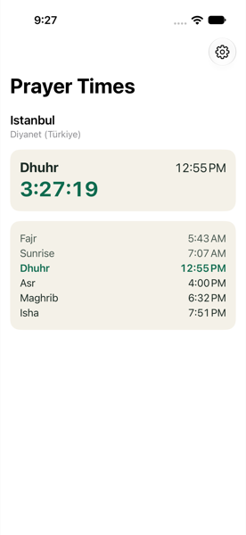
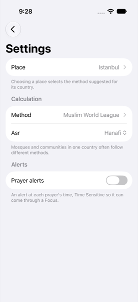
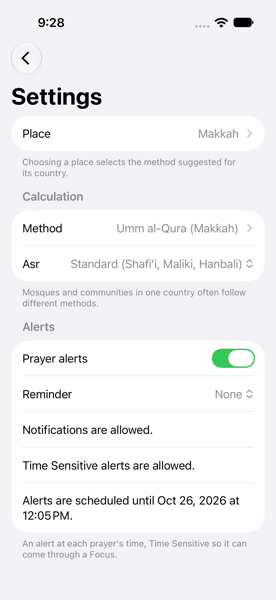
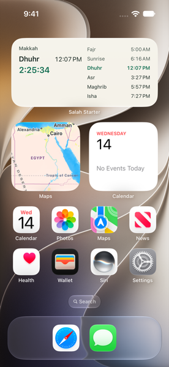
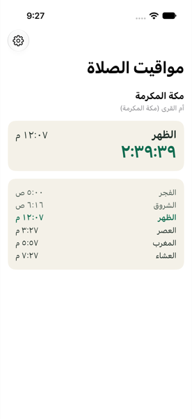

# SalahStarter

The template a new prayer-time app starts from: an iPhone app and a widget extension that share an App Group, with prayer alerts, built on SalahKit.

[](https://github.com/salah-kit/SalahStarter/actions/workflows/ci.yml)
[](LICENSE)

## What it is

A small, working app to build your own prayer app on, instead of forking someone else's. It wires [SalahKit](https://github.com/salah-kit/SalahKit) and [SalahTimes](https://github.com/salah-kit/SalahTimes) together the way they're meant to be used:

- **An iPhone app** that shows today's prayer times at a place: the next prayer with its countdown and the day's list, from SalahUI's `NextPrayerView` and `PrayerTimesList` in the app's own styles. Settings choose the place, the calculation method and the Asr convention.
- **A widget extension**: small and medium on the Home Screen, and circular, rectangular and inline on the Lock Screen. The extension builds its own timeline with SalahWidgets from the settings the app saved, so the widget stays right on the days the app isn't opened. It has its own words for every state: no place chosen yet, no times, and times that need refreshing.
- **A shared App Group**, already in both targets' entitlements. The app saves its settings with SalahWidgets' `SharedValue`, which reloads the widget only when they changed.
- **Prayer alerts** with SalahAlerts: an alert at each prayer's time and an optional reminder before it, planned two weeks ahead within iOS's limit on pending notifications. Alerts at prayer times are Time Sensitive, and the app has the **Time Sensitive capability**, so they can come through a Focus.
- **Both privacy manifests**, declaring the App Group's `UserDefaults` (reason `1C8F.1`).
- **English and Arabic**, laid out right to left in Arabic. Prayer names come from SalahKit; the app's Arabic text is machine-drafted and marked for review.
- **Tests and CI**: the widget's timelines over a week with a fixed clock; the settings, the App Group and the alerts with an in-memory notification center; journeys through the real app, including one that adds the real widget to the Home Screen.

What it deliberately isn't:

- **A finished app.** It offers a fixed list of cities, so it runs without location services. Your app adds Core Location, its own design and its own features.
- **A source of adhan audio.** Alerts use the system sound. If you add recordings, make sure you may redistribute them, and record their source in your NOTICE.
- **Connected to anything.** No accounts, servers or analytics.

| | | |
|---|---|---|
|  |  |  |
| Today: the next prayer, its countdown and the day's times | Settings: the place, the method and Asr | Alerts: allowed, Time Sensitive, and scheduled |
|  |  |  |
| The real widget before a place is chosen | The same widget after the app chose Makkah | Arabic, right to left |

The test suite renders these: they're the journeys' screenshots on an iPhone 17 simulator with iOS 27.0.

## Installation

On GitHub, choose **Use this template**, then **Create a new repository**, and clone it. Then take three steps.

### 1. Your signing team

```sh
cp Config/Local.xcconfig.example Config/Local.xcconfig
```

In `Config/Local.xcconfig`, set `DEVELOPMENT_TEAM` to your team ID, which Xcode shows in Settings > Accounts. The file is gitignored, so every developer keeps their own. Simulator builds don't need a team.

### 2. Your bundle identifiers

In `Config/Identity.xcconfig`, set your app's bundle identifier:

```
APP_BUNDLE_IDENTIFIER = com.yourcompany.Prayers
```

The widget extension's identifier follows it (`com.yourcompany.Prayers.Widget`), and so do the test bundles'.

### 3. Your App Group

In the same file, name your App Group:

```
APP_GROUP_IDENTIFIER = group.com.yourcompany.Prayers
```

Both targets' entitlements and Info.plist files read this setting, so the app and the widget always use the same group, and the code reads it from the Info.plist. Set `APP_DISPLAY_NAME` there too if you like; it's the name under the icon and in the widget gallery.

### Run it

Open `SalahStarter.xcodeproj`, choose the `SalahStarter` scheme and a simulator or your iPhone, and run. Choose a place. Then add the widget: touch and hold the Home Screen, tap Edit, then Add Widget (on iOS 17, tap +), and choose your app.

On an iPhone, Xcode's automatic signing registers your two identifiers, the App Group and the Time Sensitive capability for your team the first time it builds (from the command line, pass `-allowProvisioningUpdates` to `xcodebuild`). A free Personal Team may not offer every capability; Xcode says so when it signs. Without the Time Sensitive capability:

1. remove `com.apple.developer.usernotifications.time-sensitive` from `project.yml` and run [XcodeGen](https://github.com/yonaskolb/XcodeGen) (`xcodegen`);
2. in `SalahStarter/PrayerAlerts.swift`, make the alert at a prayer's time `.active`, and change the Alerts footer in `SalahStarter/SettingsView.swift`;
3. update the tests that check it: `content()` and `turningOn()` in `SalahStarterTests/AlertTests.swift`, and the "Time Sensitive alerts are allowed." line in `SalahStarterUITests/StarterJourneys.swift`.

## Quick start

How the pieces fit together:

```
SalahStarter/ (the app)             SalahStarterWidget/ (the extension)
  AppModel ── save ──▶ App Group ◀── load ── Provider
                     (SharedValue)          PrayerWidgetTimeline ─▶ WidgetKit
  AlertCoordinator ─▶ notifications

Shared/ (compiled into both): PrayerSettings, PrayerWidgetTimeline, PrayerDisplay,
the widget's views, the styles, the palette and the strings
```

The settings are a small `Codable` value in `Shared/PrayerSettings.swift`, stored in the App Group under a versioned key:

```swift
nonisolated struct PrayerSettings: Codable, Hashable, Sendable {
  var place: Place
  var method: CalculationMethod
  var calculation: CalculationSettings
}

nonisolated extension SharedValue where Value == PrayerSettings {
  static var prayerSettings: Self {
    SharedValue(appGroup: AppIdentity.appGroup, key: "prayerSettings.v1")
  }
}
```

The app saves them on every change, and asks WidgetKit for a reload only when they changed. Whenever WidgetKit asks, the extension loads them and builds its own schedule and timeline, without the app:

```swift
// The app (SalahStarter/AppModel.swift):
try shared.save(value, reloading: [AppIdentity.widgetKind])

// The extension (SalahStarterWidget/PrayerWidget.swift):
let timeline = PrayerWidgetTimeline(settings: SharedValue.prayerSettings.load(), now: Date())
completion(timeline.widgetKitTimeline)
```

The alerts replan whenever the app becomes active and whenever the settings change. iOS keeps a limited number of pending notifications, so the plan reaches a week or two ahead and the app keeps it topped up. The app asks for permission when the person turns alerts on; SalahKit never asks.

### Make it yours

| To change | Edit |
|---|---|
| Where it calculates | `Shared/Place.swift`: replace the presets with Core Location and a geocoder; SalahKit needs coordinates, the time zone and, for method suggestions, the country |
| What the widget knows | `Shared/PrayerSettings.swift`: add fields, and change the key's version when the stored shape changes |
| The calculation | `PrayerSettings.calculation` carries every SalahTimes parameter: angles, the high-latitude rule, rounding, minutes per prayer |
| The look | `Shared/Palette.swift` and `Shared/PrayerStyles.swift`; a unit test checks the palette's contrast |
| The widget | `Shared/PrayerWidgetView.swift` and the families in `SalahStarterWidget/PrayerWidget.swift` |
| The alerts | `SalahStarter/PrayerAlerts.swift`: what's offered, the wording and the interruption levels |
| The text | `Shared/Localizable.xcstrings`, with Arabic to review |
| The icon | `SalahStarter/Assets.xcassets/AppIcon` |
| The project's name | Easiest to keep: your app's name is `APP_DISPLAY_NAME`. To rename the project and its targets, change `project.yml` and run XcodeGen, delete the old `SalahStarter.xcodeproj`, and rename the folders, the tests' `@testable import`, and the project, scheme and folder names in `.github/workflows/ci.yml`, `scripts/lint.sh` and the commands in `CONTRIBUTING.md` |

Before you ship, have a native speaker review every translation, and test the widget and the alerts on a real iPhone for a few days: WidgetKit and the notification system decide when things happen, and only a device shows it.

## Documentation

- SalahKit's documentation: <https://salah-kit.github.io/SalahKit/>. The articles "Building widget timelines without daily app launches", "Alerts within the 64-notification limit" and "Styling rows and cards" explain what this template does and why.
- SalahTimes' documentation: <https://salah-kit.github.io/SalahTimes/>, for the calculation methods and high latitudes.
- [CONTRIBUTING.md](CONTRIBUTING.md) explains the tests, including how to run the Home Screen journey.

## Supported platforms

- iPhone with iOS 17 or later.
- Xcode 26 or later, in Swift 6 language mode. The app's targets default to the main actor, as new Xcode projects do; they also build with nonisolated default isolation.
- Tested on an iOS 27.0 simulator with Xcode 27.0, and on CI's iOS 26 simulators with Xcode 26.

## Status and versioning

The template is used from `main`; it has no releases. [CHANGELOG.md](CHANGELOG.md) lists its changes.

It depends on SalahKit `from: "0.2.0"`, and commits no `Package.resolved`, so a new project resolves the newest 0.x release of SalahKit and the SalahTimes it requires. SalahKit is before 1.0: a minor release may change its API, so read its CHANGELOG when you update. To pin the versions your app tested, remove the `Package.resolved` line from `.gitignore` and commit the file.

Everything above is proven on simulators. Signing for a device with a team, the widget and the App Group on a real iPhone, and Time Sensitive alerts arriving on a device are still to be checked on hardware.

## Contributing

See [CONTRIBUTING.md](CONTRIBUTING.md). The org-wide code of conduct and security policy live in [salah-kit/.github](https://github.com/salah-kit/.github).

## License

MIT. See [LICENSE](LICENSE) and [NOTICE](NOTICE). A project created from the template starts with these files. Your app can license its own code as you choose; keep the MIT notice for the parts that come from the template.
